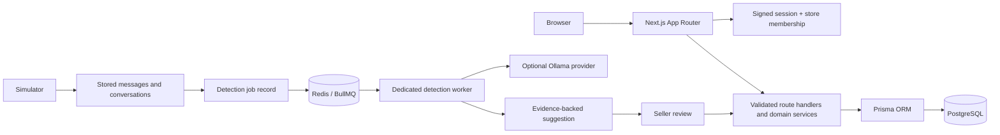

# Social Seller Order Manager

A Docker-based workspace for Cambodia-based social sellers. The current implementation focuses on order integrity, the customer relationship view, reports with explicitly defined sales totals, and seller-reviewed AI suggestions. The UI uses the reference PDF's blue navigation and clean card/table styling, while extending its Customers and Reports screens into more practical workflows.

> **Status:** Early implementation, not yet a complete production system. The supplied workspace contained only `uxpilot-react-export-1792229200835.pdf`; there was no existing application source to preserve. This app does not claim live access to social networks or validated Khmer AI accuracy.

## Run locally on Windows

Requirements: Docker Desktop (Linux containers), Git/PowerShell, and enough disk space for the images. No host PostgreSQL or Redis installation is required.

1. Copy `.env.example` to `.env`.
2. Set a unique `POSTGRES_PASSWORD`; use the exact same password in `DATABASE_URL`. Set `SESSION_SECRET` and set `SEED_OWNER_EMAIL` plus `SEED_OWNER_PASSWORD` (minimum 12 characters) for the local demo owner. Keep `.env` private.
3. From the project directory, run the local setup script:

   ```powershell
   .\scripts\setup-local-keycloak.ps1
   ```

   The script generates local-only Keycloak and Auth.js secrets, creates an ignored `.keycloak` realm import, starts Keycloak, builds the app, synchronizes the development container's dependencies, applies database migrations, and seeds the demo owner. It does not print generated secret values.

4. Check the services and app logs:

   ```powershell
   docker compose ps
   docker compose logs -f app
   ```

   PostgreSQL and Redis stay on the internal Compose network. The web app is published at <http://localhost:3000>; local Keycloak is available at <http://localhost:8180> and is bound to loopback only. The migration service waits for PostgreSQL to become healthy and runs the checked-in migrations; it does not reset existing data.

5. The setup imports the development owner into Keycloak using the `SEED_OWNER_EMAIL` and `SEED_OWNER_PASSWORD` from `.env`. Sign in at <http://localhost:3000> with those values.

The generated `.env` and `.keycloak` directory are local-only and ignored by Git. Keycloak admin credentials are stored in `.env` as `KEYCLOAK_ADMIN_USERNAME` and `KEYCLOAK_ADMIN_PASSWORD`.

### Keycloak setup

1. For the local Compose setup, the script creates the realm, confidential OpenID Connect client, and demo owner automatically. The Keycloak admin console is at <http://localhost:8180/admin>; admin credentials are in `.env`.
2. For an external Keycloak server, create a realm and an OpenID Connect client with **Client authentication** and **Standard flow** enabled. Keep the client secret on the server; do not expose it through a `NEXT_PUBLIC_` variable. Add the exact local redirect URI `http://localhost:3000/api/auth/callback/keycloak`; register the production HTTPS callback separately and restrict web origins to the app origin.
3. For an external Keycloak server, set `KEYCLOAK_ISSUER` and `KEYCLOAK_INTERNAL_URL` to its realm issuer URL, for example `https://keycloak.example.com/realms/social-seller`. Set `KEYCLOAK_CLIENT_ID` and `KEYCLOAK_CLIENT_SECRET` to the client credentials.
4. Require verified email addresses in the realm. On first sign-in, the app links a Keycloak subject to an existing local user only when Keycloak returns `email_verified: true` and the email matches a user with store membership. Subsequent sign-ins use the saved issuer/subject mapping.
5. Configure password policy, MFA, lockout and account recovery in Keycloak. The app's former password login endpoint is disabled; its store membership and role checks remain in the application database.
6. Set `NEXTAUTH_URL` to the application's public base URL and `NEXTAUTH_SECRET` to a separate random value of at least 32 characters. For example, generate one with `node -e "console.log(require('crypto').randomBytes(32).toString('base64url'))"`.

For a Keycloak user to sign in, provision a corresponding local app user and store membership first (the seed owner is created by the local setup script; owners can add users from the Users workspace section). Create the matching user in Keycloak with a verified email; the app links the identity on first sign-in. Unmatched or unverified identities are denied; linking is audited. Existing custom password/MFA endpoints are not used for sign-in after this migration.

### Optional Ollama profile

Manual order entry and other core pages do not require Ollama. To enable local inference, set `AI_MODEL` in `.env`, then start the optional service and fetch a model that you have evaluated for your language/use case:

```powershell
docker compose --profile ai up -d ollama
docker compose exec ollama ollama pull <your-evaluated-model>
docker compose restart worker
```

The worker, Redis queue, and Ollama service require additional memory and CPU/GPU capacity. Until a provider/model is configured, AI jobs will fail visibly and can be retried later; messages remain stored and manual ordering remains available.

### Useful operations

```powershell
docker compose logs -f app worker db redis
docker compose restart app worker
docker compose stop
docker compose down
docker compose up --build -d
docker compose exec app npm run db:deploy
docker compose exec app npm run db:seed
docker compose exec app npm test
docker compose exec app npm run typecheck
```

`docker compose down` preserves the named database and Redis volumes. Avoid `docker compose down -v` unless you deliberately want to erase all persisted data.

PostgreSQL backup and restore (run from PowerShell; the dump contains sensitive customer information):

```powershell
cmd /c "docker compose exec -T db pg_dump -U social_seller -d social_seller -Fc > social-seller.backup"
docker compose cp .\social-seller.backup db:/tmp/social-seller.backup
docker compose exec -T db pg_restore -U social_seller -d social_seller --clean --if-exists /tmp/social-seller.backup
```

Use the actual `POSTGRES_USER` and `POSTGRES_DB` values from `.env`. Keep backups encrypted and out of Git.

## Development without Docker

Node.js 22+ is used in the container. For local tooling, install dependencies with `npm ci`, set `DATABASE_URL`, `SESSION_SECRET`, and `REDIS_URL` in the environment, then run:

```powershell
npm run db:generate
npm run db:deploy
npm run db:seed
npm run dev
```

Local development still needs PostgreSQL and Redis. The recommended Windows workflow is Docker Compose.

## Current capabilities

- Next.js App Router / React / TypeScript, Tailwind CSS, Lucide and Recharts.
- PostgreSQL relational schema through Prisma 7 and checked-in PostgreSQL migration.
- Keycloak OpenID Connect sign-in with persisted issuer/subject identity mappings, verified-email linking to provisioned local users, and store membership checks on each request.
- SOM-branded Khmer-first app login plus a matching local Keycloak login theme, applied by rerunning `.\scripts\setup-local-keycloak.ps1`.
- Reusable success/error/info toast notifications and shared CRUD action buttons with hover, focus and disabled states.
- Product stock alerts flag tracked stock at or below five units. Inventory is advisory; order creation does not reserve stock.
- Dashboard metrics and recent real database orders.
- Dashboard sales trend, order-status distribution, recent orders, and a compact AI-review queue.
- Header-wide search across orders, customers and conversation messages; notification and user-profile dropdowns.
- Customer directory search and segments, lifetime-spend/order summary, recent order details and private seller notes; customer and note CRUD with linked-record deletion guards.
- Reports backed by order records, configurable 7/30/90-day ranges, store timezone boundaries, channel/product/status/suggestion breakdowns, CSV and multi-sheet XLSX exports, and a print-ready A4 report that can be saved as PDF from the browser print dialog.
- Order CSV/XLSX exports for the current page or selected rows; these exports do not automatically fetch every paginated order.
- Product, variant and customer CRUD, searchable product catalogue and channel/variant-aware pricing; products referenced by orders cannot be deleted.
- Manual draft or pending-confirmation orders with server-side catalogue/variant/stock/discount/fee checks, decimal money arithmetic, status history, audit records and idempotency keys; draft/pending order edits and guarded deletion are supported.
- Owners can provision local store accounts, edit roles and delete eligible accounts; Keycloak owns password, MFA, lockout and recovery policies.
- Order status-transition validation and basic reviewable order-detection workspace.
- Stored conversations and development-only simulated inbound messages. Simulation is labelled and never sends messages to a platform.
- Ollama provider interface, schema-validated output, evidence-message verification, database product matching, background queue, retry of failed jobs, and seller review before an AI draft is created.
- Development seed data uses fictional contacts and `example.test` email addresses.

## Important implementation limits

This is a foundation, **not** the complete master-prompt acceptance scope:

- The UI has focused database-backed workflows. Advanced sorting/filtering, customer address management, and product/category editing remain to be completed.
- The order service checks stock availability but does not reserve or decrement inventory. Treat displayed stock as advisory; concurrent sales can oversell until reservation/fulfilment logic is added.
- Keycloak users must have a matching provisioned local account and a verified email on first sign-in. User disablement and credential recovery are managed in Keycloak; the full application permission matrix is not implemented.
- The simulator exists only outside production. No webhook endpoints, signature verification, token vault, or platform adapters are implemented. Facebook, TikTok, and Telegram remain **Not Connected**.
- The Ollama provider is wired, but no model is bundled and no labelled Khmer-English accuracy evaluation has been run. AI classification must be treated as unverified and every output stays subject to seller review.
- Reports exclude drafts, pending confirmations and cancelled orders. Refunds are not modelled.
- The report PDF action opens the browser print dialog; choose “Save as PDF” to download a PDF file.
- No end-to-end browser suite or production deployment has been verified. Validate external platform policies/permissions and operational security before real customer use.

## Verification

Run:

```powershell
npm run typecheck
npm run lint
npm test
npm run build
docker compose config --quiet
docker compose up --build -d
```

The automated unit suite currently covers status transitions, store-local day boundaries and AI structured-output validation. Database-dependent integration tests, E2E tests and a labelled Khmer-English evaluation set are outstanding.

## Architecture and data notes



See [the AI workflow](./docs/ai-order-detection.md), [API and schema notes](./docs/api-and-schema.md), and [social integrations](./docs/social-integrations.md).
